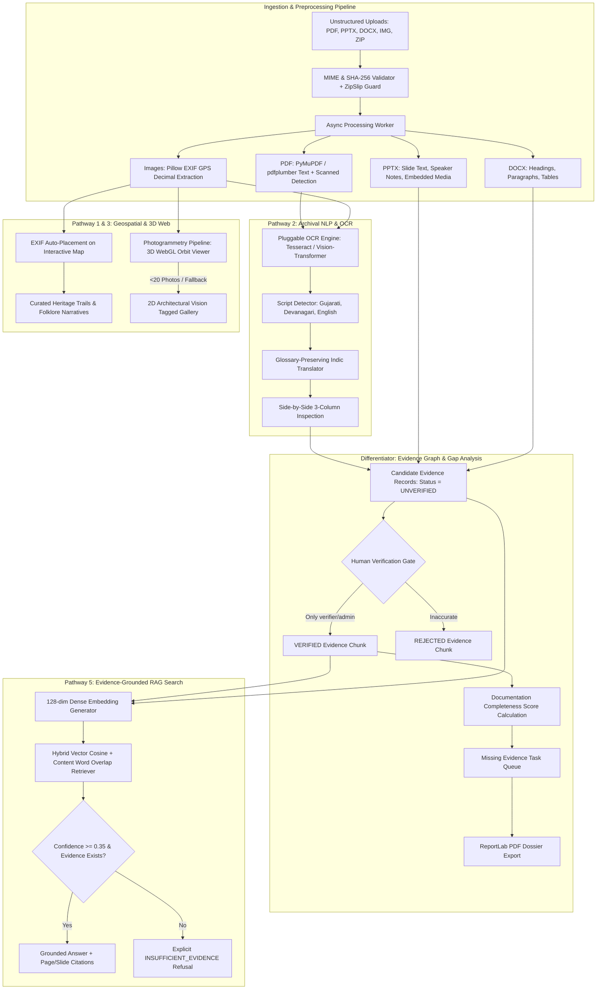

# HeritageProof System Architecture & Technical Specifications

**Hackathon Problem:** HC26-CULT01: "Digital Revitalisation of Unstructured Cultural & Architectural Heritage Archives"  
**Event:** Blithchron '27, IIT Gandhinagar (Software / Open Innovation)

---

## 1. System Architecture Overview

HeritageProof is an end-to-end archival revitalisation platform that transforms disparate, unstructured heritage materials (PDF surveys, PPTX slide decks with notes, DOCX field reports, JPG/PNG photos with EXIF GPS coordinates, and multi-file ZIP bundles) into an evidence-grounded, searchable, and visually immersive repository.



---

## 2. Core Service Separation

| Service | Technology Stack | Functionality |
| :--- | :--- | :--- |
| **API Backend** | FastAPI (Python 3.14 / 3.11), Pydantic V2 | REST API, RBAC JWT auth, health probes, validation |
| **Database** | PostgreSQL + pgvector (SQLite local fallback) | ACID persistence for sites, documents, evidence, audit logs |
| **Job Queue & Worker** | Async Worker Pipeline / Celery + Redis | Asynchronous chunking, OCR execution, retries |
| **Object Storage** | S3-Compatible Storage (MinIO locally) | Secure immutable storage for raw scans, PDFs, and 3D assets |
| **Reporting Engine** | ReportLab | High-speed PDF dossier compilation with cryptographic timestamps |
| **Frontend Client** | Vite, React 18, TypeScript, Tailwind CSS, Three.js | Responsive warm-white/terracotta interface with Public & Researcher modes |

---

## 3. Human-Only Verification Constraint (Anti-Hallucination)

```
[ AI Extraction ] ──> Claims marked status: "unverified"
                             │
                             ▼
                    [ Human Reviewer ]
                   (Role: verifier/admin)
                      /                \
                     ▼                  ▼
             [ Mark VERIFIED ]   [ Mark REJECTED ]
                     │                  │
                     ▼                  ▼
             Immutable AuditLog Entry Written
             (user_id, timestamp, note)
```

**System Charter Rule:** AI models can extract candidate claims and estimate confidence, but **can never mark a claim verified**. Only an authenticated human reviewer possessing the `verifier` or `admin` role can verify or reject claims.

---

## 4. Documentation Completeness Score & Structural Disclaimer

The **Documentation Completeness Score** assesses the historical coverage across 7 canonical dimensions:
1. `location` (Geographic coordinates, revenue records, historical boundaries)
2. `construction_date` (Epigraphic or archival establishment date + dynasty)
3. `elevations` (Tier heights, subterranean depths, terrace cross-sections)
4. `materials` (Sandstone, mortar, lime, brick specifications)
5. `features` (Sculptural friezes, step arrangements, water shafts, pavilions)
6. `condition` (Weathering, siltation, conservation status)
7. `drawings` (Architectural floor plans, measured elevation surveys)

$$\text{Completeness Score (\%)} = \left( \frac{\text{Fulfilled Checklist Items}}{\text{Total Standard Checklist Items}} \right) \times 100$$

> [!IMPORTANT]
> **Mandatory Structural Safety Disclaimer:**
> *"The Documentation Completeness Score is an archival and research coverage metric reflecting the comprehensiveness of historical records. It is strictly NOT a structural safety, civil engineering, or physical integrity evaluation."*

---

## 5. Deployment & Local Hosting

### Native Local Execution
- **Backend**:
  ```powershell
  cd backend
  .\.venv\Scripts\activate
  uvicorn app.main:app --host 0.0.0.0 --port 8000
  ```
- **Frontend**:
  ```powershell
  cd frontend
  npm run dev -- --host 0.0.0.0 --port 5173
  ```

### Docker Compose
```bash
docker-compose up --build -d
```
All environment parameters are configurable via `.env` (derived from `.env.example`).
