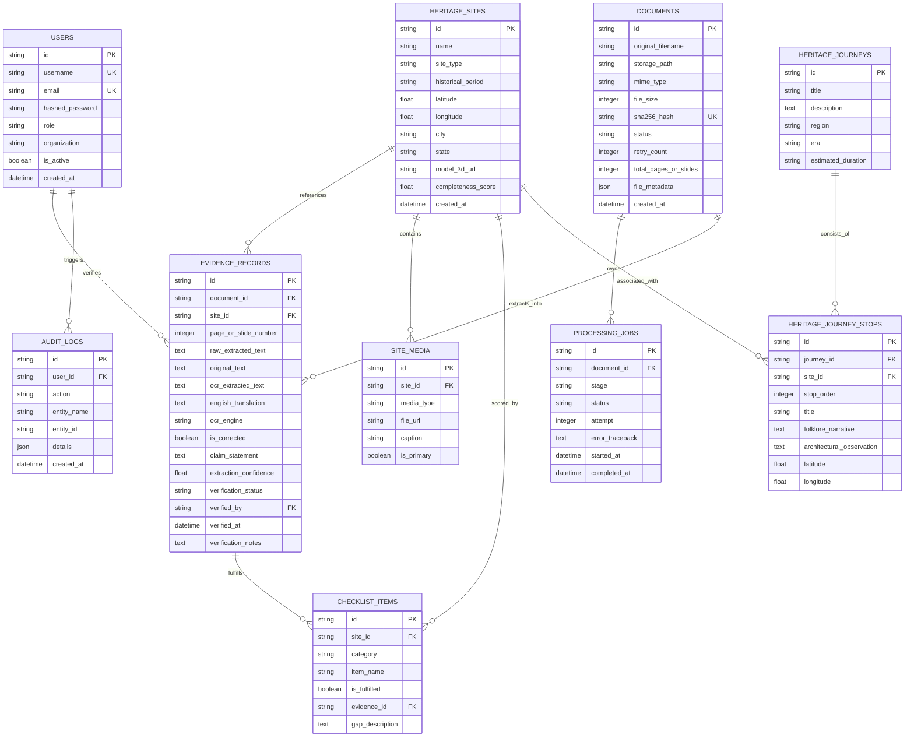

# HeritageProof — System Architecture & Design Documentation

> **Project Title**: HeritageProof: Archival Evidence Verification & Spatial Exploration Platform  
> **Repository**: [https://github.com/shivam-raj4102006/HACKCULT](https://github.com/shivam-raj4102006/HACKCULT)  
> **Public Frontend URL**: [https://hackcult-five.vercel.app](https://hackcult-five.vercel.app)  
> **Project Context**: Cultural Heritage Preservation & Provenance (HC26-CULT01 Core)  

---

## 🏛️ Executive Summary

**HeritageProof** is a digital preservation platform designed to solve the critical challenges of **unverified historical claims**, **fragmented multi-format archives**, and **AI hallucinations** in cultural heritage documentation.

Beginning with the monumental medieval architecture of Gujarat (**Rani Ki Vav**, **Sun Temple Modhera**, **Adalaj Stepwell**, and **Uparkot Fort**), HeritageProof delivers an end-to-end provenance pipeline:
1. **Multi-Format Ingestion**: Ingests PDFs, architectural PPTX decks with speaker notes, DOCX field surveys, EXIF-GPS images, and ZIP bundles with SHA-256 cryptographic deduplication.
2. **Human-Only Verification Mandate**: Enforces strict RBAC authorization where AI may extract claims and OCR inscriptions, but **only human researchers** can certify historical facts.
3. **Evidence-Grounded RAG Engine**: Utilizes 128-dimensional dense embeddings to retrieve evidence chunks with exact page/slide citations, strictly refusing to hallucinate when archival evidence is missing.
4. **Spatial Provenance & 3D Photogrammetry**: Projects monuments on an interactive WGS 84 Gujarat cartographic canvas and renders Three.js WebGL orbit models with anchored evidence hotspots.
5. **Certified Archival PDF Dossiers**: Compiles 7-category documentation completeness scores, gap remediation tasks, and audit logs into downloadable ReportLab PDF dossiers.

---

## 📑 Architecture Suite Contents

This documentation directory contains:
| File | Description |
| :--- | :--- |
| [`system-architecture.mmd`](./system-architecture.mmd) | Complete 7-layer system architecture diagram (Landscape 16:9) |
| [`data-flow.mmd`](./data-flow.mmd) | End-to-end data flow sequence diagram for 4 key operational pipelines |
| [`database-er.mmd`](./database-er.mmd) | Entity-Relationship (ER) diagram reflecting the 10 SQLAlchemy database tables |
| [`deployment.mmd`](./deployment.mmd) | Hybrid cloud and serverless deployment topology diagram |
| [`index.html`](./index.html) | Standalone interactive dark-navy visual presentation viewer with tabs & pitch scripts |

---

## 1. Complete System Architecture

```mermaid
graph TB
    subgraph CLIENT_LAYER["1. Presentation & Client Layer"]
        U_PUBLIC["👤 Cultural Tourist / Explorer<br/><i>(Read-only, 3D Orbit, Trails)</i>"]
        U_RESEARCHER["🔬 Researcher & Archivist<br/><i>(Ingestion, OCR Audit, Verification)</i>"]
        U_ADMIN["🛡️ System Administrator<br/><i>(RBAC, Security, Audit Logs)</i>"]
    end

    subgraph FRONTEND_LAYER["2. Frontend Web Application (React 18 + Vite + TailwindCSS)"]
        direction TB
        NAV["🧭 Navigation & Role Switcher<br/><code>Navbar.tsx</code> • <i>verifier vs public</i>"]
        STATUS_BADGE["🟢 Health & Demo Status Banner<br/><code>HealthBadge.tsx</code> • <i>Frontend Online</i>"]
        
        subgraph FE_MODULES["Core UI Feature Modules"]
            FE_OVERVIEW["📊 Capabilities Matrix<br/><code>App.tsx (Overview)</code>"]
            FE_INGEST["📥 Ingestion Tracker<br/><code>IngestionView.tsx</code>"]
            FE_OCR["🔤 3-Column OCR Audit<br/><code>OCRComparison.tsx</code>"]
            FE_VERIFY["✅ Verification Portal<br/><code>VerificationPortal.tsx</code>"]
            FE_RAG["🔍 Grounded Q&A<br/><code>GroundedQA.tsx</code>"]
            FE_MAP["🗺️ Gujarat Heritage Map<br/><code>HeritageMap.tsx (WGS 84)</code>"]
            FE_3D["🏛️ 3D Photogrammetry<br/><code>Model3DViewer.tsx (Three.js)</code>"]
        end

        subgraph FE_SERVICES["Client State & Data Adapters"]
            API_CLIENT["📡 API Client Layer<br/><code>src/services/api.ts</code>"]
            DEMO_STORE["💾 Canonical Demo Store<br/><code>src/services/demoData.ts</code>"]
        end
    end

    subgraph API_LAYER["3. API Gateway & Application Server (FastAPI + Uvicorn)"]
        direction TB
        FASTAPI_CORE["⚡ FastAPI Application Instance<br/><code>backend/app/main.py</code> • <i>Lifespan Management</i>"]
        CORS_MW["🛡️ CORS Middleware<br/><i>(Localhost + *.vercel.app Regex)</i>"]
        AUTH_MW["🔐 Security & Auth Dependencies<br/><code>app/api/deps.py</code> • <i>JWT Bearer + RBAC</i>"]
        
        subgraph ROUTERS["API v1 Routers (prefix: /api/v1)"]
            R_HEALTH["/health<br/><code>health.py</code>"]
            R_AUTH["/auth<br/><code>auth.py</code>"]
            R_DOCS["/documents<br/><code>documents.py</code>"]
            R_OCR["/ocr<br/><code>ocr.py</code>"]
            R_EVID["/evidence<br/><code>evidence.py</code>"]
            R_REPORTS["/reports<br/><code>reports.py</code>"]
            R_SEARCH["/search<br/><code>search.py</code>"]
            R_SITES["/sites<br/><code>sites.py</code>"]
            R_JOURNEYS["/journeys<br/><code>journeys.py</code>"]
            R_PHOTO["/photogrammetry<br/><code>photogrammetry.py</code>"]
        end
    end

    subgraph PIPELINE_LAYER["4. Ingestion, OCR & AI Processing Pipeline"]
        direction TB
        subgraph INGEST_SERVICES["Multi-Format Parsers"]
            P_PDF["📄 PDF Parser (pypdf)"]
            P_PPTX["📊 PPTX Parser (python-pptx)"]
            P_DOCX["📝 DOCX Parser (python-docx)"]
            P_IMG["🖼️ Image Parser (EXIF GPS / PIL)"]
            P_ZIP["📦 ZipSlip Validator"]
            P_HASH["🔑 SHA-256 Hasher"]
        end

        subgraph OCR_SERVICES["OCR & Translation Engine"]
            OCR_FACTORY["🏭 OCR Engine Factory"]
            OCR_TESS["🔎 Tesseract OCR"]
            OCR_VISION["👁️ Vision Transformer"]
            TRANSLATOR["🌐 Indic Translator (Guj/Dev)"]
        end

        subgraph RAG_SERVICES["Semantic Retrieval & Q&A Engine"]
            EMBED["📐 128-Dim Dense Embeddings"]
            RETRIEVER["🎯 Hybrid Vector-Lexical Retriever"]
            QA_ENGINE["🤖 Grounded Q&A Synthesizer (0.35 Threshold)"]
        end

        subgraph AUDIT_SERVICES["Analysis & Dossier Generators"]
            GAP_ANALYSIS["📈 7-Category Gap Analysis"]
            REPORT_GEN["📑 ReportLab PDF Generator"]
        end
    end

    subgraph DATA_LAYER["5. Database & Storage Layer"]
        direction TB
        SQLA_ENGINE["⚙️ SQLAlchemy 2.0 Engine"]
        
        subgraph RELATIONAL_DB["Relational Schema (SQLite / PostgreSQL)"]
            T_USERS[("users")]
            T_DOCS[("documents")]
            T_JOBS[("processing_jobs")]
            T_EVID[("evidence_records")]
            T_SITES[("heritage_sites")]
            T_MEDIA[("site_media")]
            T_CHECK[("checklist_items")]
            T_AUDIT[("audit_logs")]
            T_JOURN[("heritage_journeys")]
            T_STOPS[("heritage_journey_stops")]
        end

        subgraph FILE_STORAGE["Filesystem Storage (/tmp Fallback)"]
            FS_UPLOADS["📁 uploads/"]
            FS_REPORTS["📁 reports/"]
        end
    end

    subgraph GUARDRAILS_LAYER["6. Security & Integrity Guardrails"]
        G_HUMAN["🛑 Human-Only Verification Rule<br/><i>AI cannot certify claims</i>"]
        G_INTEGRITY["🔐 Cryptographic Deduplication<br/><i>SHA-256 Provenance Fingerprint</i>"]
        G_DISCLAIMER["⚠️ Conservation Safety Disclaimer<br/><i>Archival Metric ≠ Structural Safety</i>"]
        G_REFUSAL["🚫 Anti-Hallucination Fallback<br/><i>Strict Refusal when Score < 0.35</i>"]
    end

    subgraph DEPLOY_LAYER["7. Hosting & Infrastructure"]
        V_FE["☁️ Vercel Edge Frontend (hackcult-five.vercel.app)"]
        V_BE["⚡ Vercel Serverless / AWS Lambda (/api/index.py)"]
        GH_REPO["🐙 GitHub Repository (shivam-raj4102006/HACKCULT)"]
    end

    CLIENT_LAYER --> FRONTEND_LAYER
    NAV --> FE_MODULES
    FE_MODULES --> API_CLIENT
    API_CLIENT -.-> DEMO_STORE
    API_CLIENT ==> FASTAPI_CORE
    FASTAPI_CORE --> CORS_MW
    CORS_MW --> AUTH_MW
    AUTH_MW --> ROUTERS
    R_DOCS --> INGEST_SERVICES
    R_OCR --> OCR_SERVICES
    R_SEARCH --> RAG_SERVICES
    R_EVID --> GAP_ANALYSIS
    R_REPORTS --> REPORT_GEN
    R_SITES & R_JOURNEYS --> SQLA_ENGINE
    INGEST_SERVICES --> P_HASH
    P_HASH --> FS_UPLOADS
    REPORT_GEN --> FS_REPORTS
    ROUTERS ==> SQLA_ENGINE
    SQLA_ENGINE ==> RELATIONAL_DB
    R_EVID -.-> G_HUMAN
    GAP_ANALYSIS -.-> G_DISCLAIMER
    QA_ENGINE -.-> G_REFUSAL
    FRONTEND_LAYER -.-> V_FE
    API_LAYER -.-> V_BE
    GH_REPO -.-> V_FE
    GH_REPO -.-> V_BE
```



### Layer-by-Layer Architectural Breakdown

1. **Client & Presentation Layer**:
   - Offers distinct view experiences: **Public Storytelling Explore Mode** (optimized for tourists and students) and **Researcher / Verifier Workspace** (unveils ingestion dropzones, OCR correction controls, and verification certifiers).
2. **Frontend UI Layer (`frontend/src/`)**:
   - Single Page Application built on React 18, Vite 6, and Tailwind CSS.
   - Includes Three.js WebGL canvas for interactive 3D orbit controls and evidence hotspot anchors.
   - Includes WGS 84 Gujarat cartographic projections with royal trail vector polylines.
   - Features resilient client-side demo adapters (`demoData.ts` & `api.ts`) ensuring flawless operation even when disconnected from a live backend cluster.
3. **API & Gateway Layer (`backend/app/main.py`)**:
   - Powered by FastAPI and ASGI Uvicorn server.
   - Configured with Starlette CORS middleware supporting `localhost`, `127.0.0.1`, and wildcard regex for `https://*.vercel.app`.
   - Lifespan context manager gracefully handles read-only serverless filesystems by dynamically routing to `/tmp`.
4. **AI, Ingestion & Analysis Pipeline**:
   - **Multi-Format Extraction**: `pypdf`, `python-pptx`, `python-docx`, `Pillow` (EXIF GPS parsing), and ZipSlip-protected unpacker.
   - **Pluggable OCR**: Factory pattern allowing swapping between system Tesseract and Vision Transformer models.
   - **Dense Embeddings & RAG**: 128-dimensional normalized dense vectors capturing Indic subword character n-grams. Hybrid retriever combines 60% semantic similarity with 40% lexical keyword overlap.
   - **Anti-Hallucination Guardrail**: Strict similarity threshold of `0.35`. Any score below this triggers an explicit `INSUFFICIENT_EVIDENCE` refusal.
5. **Database & Storage Layer**:
   - Managed via SQLAlchemy 2.0 ORM with 10 relational entities.
   - SQLite with WAL mode locally; `/tmp/heritageproof.db` on serverless; zero-code migration path to PostgreSQL (`psycopg2` / `asyncpg`).
6. **Security & Guardrail Layer**:
   - **Human-Only Verification Mandate**: AI extracts claims, but only certified human auditors can verify them.
   - **SHA-256 Provenance Fingerprinting**: Prevents duplicate ingestion and ensures tamper evidence.
   - **Civil Safety Disclaimer**: Explicitly states that completeness scores reflect archival coverage, strictly not structural or civil engineering integrity.
7. **Deployment Layer**:
   - Edge-hosted static assets on Vercel CDN.
   - Serverless Python functions on AWS Lambda / Amazon Linux container.
   - Ephemeral `/tmp` storage for zero-downtime cold starts.

---

## 2. End-to-End Data Flow

```mermaid
sequenceDiagram
    autonumber
    actor User as 👤 User / Researcher
    participant FE as 🖥️ React Frontend
    participant API as ⚡ FastAPI (/api/v1)
    participant Worker as ⚙️ Ingestion & RAG Worker
    participant DB as 🗄️ Database (SQLAlchemy)
    participant FS as 📁 Storage (/tmp/storage)

    rect rgb(15, 23, 42)
        note over User, FS: Pipeline 1: Ingestion & Cryptographic Provenance
        User->>FE: Drop file (PDF, PPTX, DOCX, ZIP) into IngestionView
        FE->>API: POST /api/v1/documents/upload (multipart)
        API->>Worker: Compute SHA-256 fingerprint & validate
        alt Unique Document
            Worker->>FS: Store in storage/uploads/{sha256}.{ext}
            Worker->>DB: Insert Document (status="QUEUED") & ProcessingJob
            Worker->>Worker: Parse text, notes, EXIF GPS & create EvidenceRecords
            Worker->>DB: Update Document status="processed"
            API-->>FE: HTTP 201 Created (Document details & SHA-256)
        end
    end

    rect rgb(19, 42, 60)
        note over User, FS: Pipeline 2: Grounded Q&A & Anti-Hallucination Refusal
        User->>FE: Enter natural language query in GroundedQA
        FE->>API: POST /api/v1/search/qa { query, only_verified }
        API->>Worker: generate_text_embedding(query) [128-dim dense vector]
        Worker->>DB: Retrieve candidate EvidenceRecords
        Worker->>Worker: Hybrid Score = (0.60 * CosineSim) + (0.40 * KeywordOverlap)
        alt Score >= 0.35 (Supporting Evidence Found)
            Worker-->>API: status="GROUNDED_ANSWER" with exact page/slide citations
            API-->>FE: HTTP 200 OK with citations & snippet provenance
        else Score < 0.35 (Insufficient Archival Evidence)
            Worker-->>API: status="INSUFFICIENT_EVIDENCE" (Strict refusal)
            API-->>FE: HTTP 200 OK (Refusal message, no false claims)
        end
    end

    rect rgb(28, 25, 23)
        note over User, FS: Pipeline 3: Human Verification Lifecycle & Audit Log
        User->>FE: Verifier audits claim in VerificationPortal and clicks "Verify"
        FE->>API: POST /api/v1/evidence/review { evidence_id, status: "verified" }
        API->>DB: Update EvidenceRecord (verification_status="verified", verified_by=User.id)
        API->>DB: Insert AuditLog { action: "EVIDENCE_VERIFIED", entity_id, timestamp }
        API->>Worker: compute_gap_analysis(site_id)
        Worker->>DB: Update HeritageSite.completeness_score
        API-->>FE: HTTP 200 OK (Updated status & new completeness %)
    end

    rect rgb(30, 41, 59)
        note over User, FS: Pipeline 4: ReportLab PDF Dossier Export
        User->>FE: Clicks "Download PDF Dossier Report"
        FE->>API: GET /api/v1/reports/site/{site_id}/download-direct
        API->>Worker: generate_pdf_dossier(site_id, db)
        Worker->>FS: Render ReportLab PDF with tables, score badge & disclaimer
        API-->>FE: HTTP 200 FileResponse (application/pdf attachment)
        FE-->>User: Instant certified archival PDF download
    end
```



---

## 3. Database Entity-Relationship (ER) Diagram



---

## 4. Deployment Topology

```mermaid
graph TB
    subgraph DEV_ENV["Local Workstation Environment"]
        DEV_GIT["🔧 Git CLI & GitHub Desktop"]
        DEV_VITE["⚡ Vite Dev Server (port 5173)"]
        DEV_FASTAPI["🐍 FastAPI Dev Server (port 8000)"]
        DEV_SQLITE[("📁 heritageproof.db (Local)")]
    end

    subgraph SCM["GitHub Repository"]
        GH_REPO["🐙 https://github.com/shivam-raj4102006/HACKCULT<br/><i>Branch: main</i>"]
    end

    subgraph VERCEL_CLOUD["Vercel Cloud Platform"]
        subgraph VERCEL_FE["Frontend Edge Project ('hackcult')"]
            V_ROUTER["🌐 Vercel Edge CDN<br/><code>https://hackcult-five.vercel.app</code>"]
            V_SPA_REWRITE["🔀 SPA Rewrite Engine<br/><code>frontend/vercel.json</code>"]
            V_STATIC["📦 Vite SPA Static Bundle (dist/)"]
        end

        subgraph VERCEL_BE["Serverless Python Runtime"]
            V_ENTRY["⚡ ASGI Bridge (api/index.py)"]
            V_APP["🐍 FastAPI Core (app/main.py)"]
            V_TMP["💾 Ephemeral Storage (/tmp)"]
        end

        subgraph VERCEL_ENV["Configuration"]
            ENV_VARS["⚙️ VERCEL=1 • SECRET_KEY • DATABASE_URL"]
        end
    end

    subgraph EXTERNAL["External Integrations"]
        EXT_OSM["🗺️ OpenStreetMap / Leaflet (WGS 84 Tiles)"]
        EXT_UNSPLASH["🖼️ Unsplash CDN (Field Photos)"]
        EXT_POSTGRES[("🐘 Optional PostgreSQL (Neon / Supabase)<br/><i>[Production Extension]</i>")]
    end

    DEV_GIT -->|git push origin main| GH_REPO
    DEV_VITE -.->|/api proxy| DEV_FASTAPI
    DEV_FASTAPI --> DEV_SQLITE
    GH_REPO ==>|Auto CI/CD Webhook| VERCEL_FE
    GH_REPO ==>|Auto CI/CD Webhook| VERCEL_BE
    V_ROUTER --> V_SPA_REWRITE
    V_SPA_REWRITE --> V_STATIC
    V_ROUTER -.->|/api/(.*) rewrites| V_ENTRY
    V_ENTRY --> V_APP
    V_APP --> V_TMP
    ENV_VARS -.-> V_APP
    V_APP -.-> EXT_POSTGRES
    V_STATIC --> EXT_OSM & EXT_UNSPLASH
```

---

## 5. Technical Presentation Script (For Judges)

### 🎙️ English (2–3 Minutes)
> "Good morning, judges! Today we present **HeritageProof** — a digital archival verification, spatial provenance, and multimodal exploration platform designed for historical monuments, starting with the medieval heritage of Gujarat.
>
> Historical preservation faces three critical challenges: **unverified claims**, **fragmented multi-format archives**, and **AI hallucinations**. HeritageProof addresses these through a strict 7-layer architecture:
>
> 1. **Ingestion Layer**: Our pipeline ingests multi-format records — survey PDFs, PPTX decks with speaker notes, DOCX field surveys, EXIF GPS images, and ZIP bundles. Every upload is fingerprinted with a **cryptographic SHA-256 hash** for tamper-evident provenance.
> 2. **Human-Only Verification Mandate**: In strict compliance with our system charter, AI extracts claims and OCR models transcribe Gujarati and Devanagari inscriptions, but **only certified human researchers can certify historical claims**. Every decision is permanently stored in an immutable audit log.
> 3. **Grounded RAG Engine**: Our search engine uses 128-dimensional dense embeddings to retrieve evidence with exact page, slide, and snippet citations. If an archival citation is absent, our system **strictly refuses to hallucinate** by returning an explicit `INSUFFICIENT_EVIDENCE` fallback.
> 4. **Spatial Provenance & Photogrammetry**: We project monuments onto an interactive WGS 84 cartographic map, map out the Solanki Royal Trail, and render Three.js 3D photogrammetric models with spatial evidence hotspots.
> 5. **Archival Completeness & PDF Dossiers**: We track archival coverage across 7 canonical categories and generate certified ReportLab PDF dossiers on demand.
>
> With HeritageProof, cultural heritage is not just digitized — it is authenticated, preserved, and made accessible for generations to come."

### 🎙️ Hinglish (2–3 Minutes)
> "Namaste judges! Aaj hum present kar rahe hain **HeritageProof** — ek digital platform jo hamare historical monuments ke archival records ko authenticate karta hai aur unhe interactive 3D aur geospatial maps ke zariye explore karne deta hai.
>
> Problem yeh hai ki internet par historical facts aksar distorted hote hain, aur generic AI models bina evidence ke fake stories hallucinate kar dete hain. Isko solve karne ke liye humne ek comprehensive 7-layer architecture banaya hai:
>
> 1. **Ingestion Pipeline**: Hamara system multi-format documents accept karta hai — ASI ke survey PDFs, presentation decks, field reports, EXIF GPS photos aur ZIP bundles. Har document ko ek unique **SHA-256 cryptographic hash** milta hai taaki provenance tamper-evident rahe.
> 2. **Human-Only Verification**: Hamara AI Devanagari aur Gujarati inscriptions ko extract aur translate zaroor karta hai, lekin **claim ko verify sirf verified human researchers hi kar sakte hain**. AI ko verification ka right nahi hai.
> 3. **Grounded RAG Search**: Jab user koi sawal poochta hai, hamara retrieval engine exact page number aur snippet cite karta hai. Agar archive mein answer available nahi hai, toh system guess karne ke bajaye cleanly refuse kar deta hai — zero hallucination.
> 4. **Interactive Gujarat Map & 3D Viewer**: Hamare paas WGS 84 Gujarat map par Solanki Royal Trail hai aur Three.js se 3D models par anchored evidence hotspots dikhte hain.
> 5. **Instant PDF Dossier**: Kisi bhi monument ka 7-category completeness score aur ReportLab se generated certified PDF dossier instantly download kiya ja sakta hai.
>
> Toh chahe researcher ho ya tourist, HeritageProof guarantees complete scientific verification."

---

## 6. How to Open the Interactive Architecture Viewer

To view the dark-navy interactive architecture visualizer in your local browser:

1. Open the file directly in Google Chrome, Microsoft Edge, or Firefox:
   ```text
   C:\Users\Shivam\.gemini\antigravity\scratch\heritageproof\docs\architecture\index.html
   ```
2. Or serve it via Vite / local static server:
   ```powershell
   npx serve docs/architecture
   ```
3. Use the top navigation bar to toggle between **System Architecture**, **Data Flow**, **Database ER**, **Deployment Topology**, and the **Presentation Pitch Deck**.
